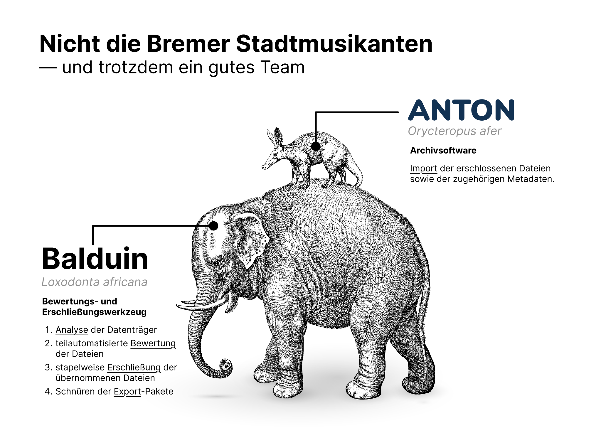

<p align="center">
  
</p>

<h1 align="center">Balduin</h1>

<p align="center">
  <a href="../../releases"></a>
  <a href="LICENSE"></a>
  
  
  <a href="https://github.com/kraenzle-ritter/anton-import-format"></a>
  <a href="REUSE.toml"></a>
  
</p>

---

Schon lange machen sie den berühmt-berüchtigten Banenankisten in Archivmagazinen still und heimlich Konkurenz: die Sammlung digitaler Daträger. Festplatten akurat gestapelt, haufenweise USB-Sticks oder sauber geschichtet glitzrige CD-Roms. Darauf tausende von Fotos, `Präsentation_final.pptx`und `Präsentation_final_wirklich_fertig.pptx` oder Ordner vom Kaliber `Backup_alt_NICHT LÖSCHEN`. Kennen Sie noch `.flv`-Dateien? Terrabyte an Archivarsalpträumen. 
Drum denkt man sich, die liegen da gut, denn es gibt ganz andere dringede Baustellen im Archiv. Aber ein USB-Stick ist kein digitales Archiv! 

Hier kommt **Balduin** ins Spiel. Es erfindet das Rad nicht neu, aber bringt alle Werkzeuge mit, die es braucht, um den schieren Datenmengen habhaft zu werden und macht daraus einem geordneten, transparenten und flexiblen Prozess, der ohne großes Technikverständnis bedient werden kann.

Baduin herunterladen, im Browser öffnen, Datenträger anhängen, lesend Analysen erstellen, alle gefunden Dateien teilautomatisiert bewerten und Stapelweise erschließen und ganz entspannt in die Archivdatenbank einspielen. 

Derzeit setzt Balduin voraus, dass Ihr Archiv das Archivinformationssystem Anton verwendet, welches ebenfalls komplett im Browser läuft. Sie kennen Anton noch nicht? [Ein Blick lohnt sich!](https://anton.ch)

Balduin ist das Produkt einer Zusammenarbeit mit [Kränzle & Ritter](https://k-r.ch) und der generösen Zeit als Scholar in Residence der [Stiftung Eisenbibliothek](https://www.eisenbibliothek.ch) der Firma Georg Fischer in Schaffhausen. Beiden sei an dieser Stelle herzlich für die Unterstützung gedankt! 
<p align="left">
  <a href="https://www.eisenbibliothek.ch">
    <picture>
      <source media="(prefers-color-scheme: dark)" srcset=".github/logos/eisenbibliothek_dunkel.svg">
      
    </picture>
  </a>
</p>

## ✨ Highlights

- **Doppelklick statt Kommandozeile.** Installieren, starten, im Browser arbeiten – ohne Python, Terminal oder
  Konfigurationsdateien.
- **Nichts geht kaputt.** Datenträger werden nur gelesen, Kassieren markiert nur, jede Änderung bleibt mit altem Wert
  im Protokoll.
- **Alles im Blick.** Jede Analyse liefert umfangreiche Übersichten und Diagramme der Inhalte der Datenträger und Einzeldateien werden nach Archivfähigkeit und Bearbeitungsstatus gekennzeichnet. 
- **Pause jederzeit.** Lange Analysen laufen im Hintergrund weiter, lassen sich abbrechen und später fortsetzen. Das gleiche gilt für Bewertung und Erschließung. 
- **Dubletten über alle Datenträger.** Exakte Kopien, Formatvarianten (TIFF und JPEG desselben Bildes) und beinahe
  gleiche Fotos – und was davon schon in Anton liegt.
- **Formate und Risiken je Datei.** PRONOM-Kennung, Virenscan und eine Ampel zur Archivfähigkeit nach eigenen Regeln
  und NARA. 
- **Metadaten aggregieren.** Metadaten der Dateien werden aggregiert und dienen sowohl als Hilfe bei Bewertung und Erschließung als auch als Inhalte für zugehörige ISAD(G)-Felder. 
- **Vorschläge, keine Automatik.** Titel, Daten, Orte und Schlagworte aus Pfaden, Metadaten und Bildinhalt –
  übernommen wird nur, was ein Mensch bestätigt.
- **Daten bleiben im Haus.** Kein Konto, keine Cloud: Bildanalyse und Sprachmodell laufen lokal. Die
  Personenerkennung ist abschaltbar und erkennt nur, *dass* Personen im Bild sind, nicht *wer*.

<p align="center">
  <picture>
    <source media="(prefers-color-scheme: dark)" srcset=".github/infografik_dark.png">
    
  </picture>
</p>

## 🧭 Wie und wo anfangen?

<p align="center">
  <a href="#archivarinnen"><kbd>&nbsp;<br>&nbsp;🧚🏻‍♀️&nbsp;<b>Ich bin Archivar:in</b>&nbsp;<br>&nbsp;und möchte Balduin nutzen →&nbsp;<br>&nbsp;</kbd></a>
  &nbsp;
  <a href="#entwicklerinnen"><kbd>&nbsp;<br>&nbsp;🧑🏽‍💻&nbsp;<b>Ich bin Entwickler:in</b>&nbsp;<br>&nbsp;und möchte beitragen oder adaptieren →&nbsp;<br>&nbsp;</kbd></a>
  &nbsp;
  <a href="#elefant"><kbd>&nbsp;<br>&nbsp;🐘&nbsp;<b>Ich bin hier,</b>&nbsp;<br>&nbsp;weil ich den Elefanten süß finde →&nbsp;<br>&nbsp;</kbd></a>
</p>

<a id="archivarinnen"></a>

## 🗄️ Für Archivar:innen

> [!IMPORTANT]
> **Balduin arbeitet derzeit nur mit der Archivsoftware [Anton](https://anton.ch).** Bewertung und Erschließung
> funktionieren auch ohne Anton, aber der Abgleich mit dem Bestand, das Vokabular für die Erschließung und der
> Export setzen eine Anton-Instanz voraus. Exportiert wird ausschließlich im
> [Anton-Importformat](https://github.com/kraenzle-ritter/anton-import-format); den Import führt der Betreiber der
> Instanz aus.

### ⬇️ Herunterladen

Die aktuelle Fassung liegt unter [**Releases**](../../releases):

| System | Datei |
|---|---|
| Mac mit Apple-Chip (M1 und neuer) | `Balduin-…-Mac-AppleChip.dmg` |
| Mac mit Intel-Prozessor | `Balduin-…-Mac-Intel.dmg` |
| Windows 10/11 (64 Bit) | `Balduin-…-Windows-Setup.exe` |
| Linux x86_64 (**Alpha**) | `Balduin-…-Linux-x86_64-alpha.tar.gz` |

Alles Nötige ist dabei, auch Python und die Werkzeuge für Formaterkennung, Metadaten, Vorschaubilder und
Virenscan.

<details>
<summary>🔐 <b>Download prüfen (für all jene, die es ganz genau nehmen)</b></summary>

Zu jeder Datei liegt ihre Prüfsumme (SHA-256) als `.sha256` bei. Stimmt sie mit der Prüfsumme der
heruntergeladenen Datei überein, ist die Datei vollständig und unverändert – wichtig, solange die Pakete noch nicht
signiert sind, und praktisch, wenn Balduin per Stick auf einen Rechner ohne Internet kommt.

```bash
shasum -a 256 Balduin-…-Mac-AppleChip.dmg        # Mac
sha256sum Balduin-…-Linux-x86_64-alpha.tar.gz     # Linux
```

```powershell
Get-FileHash Balduin-…-Windows-Setup.exe          # Windows (PowerShell)
```

Die ausgegebene Zeichenfolge mit dem Inhalt der `.sha256` vergleichen; Groß- und Kleinschreibung spielt keine
Rolle. Weicht sie ab, die Datei neu herunterladen. Die Prüfsumme liegt auf derselben Seite wie das Paket: Sie
erkennt beschädigte Downloads, ersetzt aber keine Signatur.

</details>

### 🚀 Installieren und starten

- **Mac:** dmg öffnen, Balduin in den Ordner „Programme“ ziehen. Die Fassung ist noch nicht von Apple beglaubigt:
  beim ersten Start meldet macOS „„Balduin“ nicht geöffnet“; die Meldung mit „Fertig“ schließen, dann unter
  Systemeinstellungen › Datenschutz & Sicherheit im Abschnitt „Sicherheit“ „Dennoch öffnen“ wählen und mit dem
  Passwort bestätigen. Balduin läuft danach mit einem Symbol im Dock.
- **Windows:** Installer ausführen. Er ist noch nicht signiert; meldet Windows „Der Computer wurde durch Windows
  geschützt“, über „Weitere Informationen“ › „Trotzdem ausführen“ fortfahren. Balduin läuft danach mit einem Symbol
  im Infobereich.
- **Linux (Alpha):** Archiv entpacken, `./balduin.sh` starten; benötigte Pakete nennt `LIESMICH-ALPHA.txt`.

Balduin öffnet sich im Browser mit dem Startbildschirm: **„Neues Projekt“** führt durch die Einstellungen (Name,
Projektkürzel, Speicherort, Vorschaubilder, Virenscan, Personenerkennung). Danach den ersten Datenträger
anschließen und in **Registrierung/Analyse** registrieren. Die Adresse der Anton-Instanz und den API-Token
eintragen: in den Einstellungen (Zahnrad vorn in der Modulleiste).

### 🧰 Was Balduin kann

| Modul | Was es tut |
|---|---|
| **1 Registrierung/Analyse** | Datenträger (Festplatte, USB-Stick, CD, Speicherkarte), einzelne Ordner oder Abbilder von Mac-Datenträgern registrieren, mit Etikett (Text und Foto) und Angaben zum Datenträger. Die Analyse läuft im Hintergrund, abbrechbar und fortsetzbar: Verzeichnis, Prüfsummen (SHA-256, MD5), Formate (PRONOM), Virenscan, Metadaten, Texte aus Dokumenten, Vorschaubilder (auch für Filme und PDFs), Personen auf Fotos (optional), Dubletten, Abgleich mit Anton, Archivfähigkeit nach eigenen Regeln und dem NARA Digital Preservation Framework. Archivdateien (ZIP, tar, gz …) erscheinen wie Ordner. |
| **2 Bewertung** | Bäume aller Datenträger mit Balken für Umfang und Stand, Galerie und Inspektor. Übernehmen, kassieren, zurückstellen – für Dateien, Ordner oder ganze Datenträger, mit Vererbung, Vorbehalt und Sperre. Regeln im Editor (Formate, kleine Bilder, Programme, exakte Kopien), Schutzregel für Dubletten, Erschließungshinweise. Kassieren markiert nur, gelöscht wird nichts. |
| **Vorlauf** | Bereitet die Erschließung vor: Pfade und Dateinamen auswerten, Metadaten verteilen, Titel vorschlagen, Bildinhalte erkennen, Normdaten mit dem Vokabular der Anton-Instanz abgleichen, verwandte Ordner finden. Ergibt nur Vorschläge, mit Quelle und Score. |
| **3 Erschließung** | Editor im Aufbau der Anton-Maske: Titel, Laufzeit, Form und Inhalt, Akteur:innen, Orte, Schlagworte, Sprachen, weitere Anton-Felder. Werte gelten am Element und werden per Knopf vererbt. Vorschläge bestätigen oder verwerfen; Zuordnen zu bestehenden Verzeichnungseinheiten aus Anton oder zu neuen Verzeichnungseinheiten darunter, mit Stufe. Ein lokales Sprachmodell hilft auf Abruf. |
| **4 Bestand und Export** | Übersicht nach Datenträgern oder Beständen mit allem, was noch zu tun ist. Freigabe, dann Packen als Schritt-für-Schritt-Anleitung: Pakete (BagIt als tar mit `metadata.json`) direkt vom schreibgeschützten Datenträger, Prüfsummen gegen die Datenbank, nachgeprüft, mit Lieferschein. Danach Übergabe an den Betreiber der Anton-Instanz, Kontrolle in Anton und Abschlussbericht. |
| **Dashboard** | Gesamtstand des Projekts; „Als Bericht speichern“ ergibt eine eigenständige HTML-Datei, die ohne Balduin und ohne Internet lesbar ist. |

### 📜 Grundregeln

Balduin sagt dem Archiv Folgendes zu; automatische Tests (`tests/test_schutzregeln.py`) prüfen es bei jeder Änderung.

1. **Quellen nur lesen.** Auf Quelldatenträgern und als Quelle registrierten Ordnern wird nichts geschrieben,
   verschoben, umbenannt oder gelöscht; Datenträger werden schreibgeschützt eingehängt. Unter Windows geht das nicht:
   Dort liest Balduin nach einer Rückfrage ohne Schreibschutz (das System kann dann eigene kleine Dateien anlegen,
   der Bestand bleibt unverändert; protokolliert und in der Bestandsgeschichte vermerkt) oder über einen
   Writeblocker. Geschrieben wird nur in den Projektordner, auf einen gewählten Datenträger für Vorschaubilder und in
   die Ablage der Exportpakete.
2. **Die Datenbank des Projekts (`inventar.sqlite`) ist die einzige Wahrheit.** CSV und HTML sind Arbeitsblätter
   oder Berichte.
3. **Jede Änderung wird protokolliert** (Zeit, Abschnitt, Objekt, Feld, alter und neuer Wert).
4. **Kassieren heißt markieren, nicht löschen.** Originale werden erst beim Export kopiert, direkt von der
   schreibgeschützten Quelle in Pakete, mit Prüfsummenvergleich und Nachprüfung.
5. **Speicher schonen:** Vor platzintensiven Schritten prüft Balduin den freien Platz und hält an, bevor der
   Datenträger vollläuft; vor einer Analyse nennt es, was die Vorschaubilder ungefähr brauchen.
6. **Inhaltsanalyse bleibt lokal.** Keine Bilder oder Texte an Cloud-Dienste; an Normdatendienste (GND, Wikidata)
   gehen nur einzelne Begriffe, Namen oder IDs, jede Abfrage protokolliert.
7. **Vorschläge werden nie automatisch übernommen;** sie tragen Quelle und Score und werden von Menschen bestätigt.

### 🚧 Stand

Entwickelt und im Einsatz auf macOS; Windows ist geprüft, Linux eine Alpha. Die Pakete sind noch nicht signiert.
Das Anton-Importformat ist bis Version 1.0 nicht stabil; Balduin richtet sich nach der Version, die die Zielinstanz
liest.

<a id="entwicklerinnen"></a>

## 🛠️ Für Entwickler:innen

### 💻 Aus dem Quelltext starten

Balduin braucht Python 3.13 und Git. Auf dem Mac:

```bash
git clone <Adresse dieses Repos> balduin
cd balduin
python3.13 -m venv .venv
.venv/bin/python -m pip install -r requirements-entwicklung.txt   # Laufzeit plus Tests
.venv/bin/python werkzeuge/modelle_laden.py                        # Modelle der Bildanalyse (optional)

brew install exiftool ffmpeg poppler clamav smartmontools
brew install richardlehane/digipres/siegfried

./Balduin.command
```

Zum Ausprobieren ohne echte Datenträger:

```bash
.venv/bin/python werkzeuge/testplatten_erzeugen.py
./Balduin.command --volumes "$PWD/testplatten"
```

Ausführlich, auch für Linux: [EINRICHTUNG.md](EINRICHTUNG.md).

### 🧪 Testen

```bash
.venv/bin/python -m pytest                       # alle Tests
.venv/bin/python -m pytest -m "not integration"  # ohne die Tests, die Läufe und Server starten (siehe tests/LIESMICH.md)
```

Kein Test berührt echte Datenträger oder eine echte Anton-Instanz: Eine Schutzwache sperrt Zugriffe auf
eingehängte Datenträger, Anton wird lokal nachgebaut. Mehr in [tests/README.md](tests/README.md).

### 📦 Bauen

`auslieferung/bauen.py` baut je System einen Programmordner mit eigenem Python, Werkzeugen und Modellen und daraus
das Paket (dmg, Installer, tar.gz). Der Workflow `.github/workflows/auslieferung.yml` baut alle Systeme bei einem
Tag `v*`. Einzelheiten: [auslieferung/README.md](auslieferung/README.md).

```bash
python auslieferung/bauen.py               # Paket für das laufende System
python auslieferung/bauen.py --nur-ordner  # nur den Programmordner
```

### 🗂️ Aufbau

| Pfad | Inhalt |
|---|---|
| `tool/` | Server (nur Python-Standardbibliothek, nur 127.0.0.1) und Oberfläche in HTML, CSS und JS ohne Build-Schritt und ohne Fremdbibliotheken |
| `erfassung/` | Rechencode von Modul 1, je Schritt eine Datei; `lauf.py` führt die Läufe im Hintergrund aus |
| `vorlauf/` | Rechencode des Vorlaufs |
| `export/` | Rechencode von Modul 4: Pakete bauen und prüfen, Lieferschein |
| `vorgaben/` | Regeltabellen, Schema des Anton-Importformats, NARA Digital Preservation Framework |
| `modelle/` | Modelle der Bildanalyse (nicht im Repo; Herkunft und Lizenz in `modelle/README.md`) |
| `werkzeuge/` | Hilfsskripte: Testplatten, Modelle und NARA-Daten laden |
| `auslieferung/` | Bau der Pakete für Mac, Windows und Linux |
| `tests/` | automatische Tests mit pytest |

Projekte (Datenbank, Vorschaubilder, Berichte, Pakete) liegen nie im Code-Ordner, sondern je Projekt in einem eigenen
Ordner.

Ein paar Leitlinien, die den Code zusammenhalten:

- **Plattformabhängiges nur in `erfassung/system.py`.** Systemwerkzeuge, Pfade und Dialoge je Aufgabe in einer
  Funktion; ein Test prüft, dass sie nirgends sonst stehen.
- **Server und Rechencode getrennt.** Der Server liest und schreibt die Datenbank; alles Rechenintensive läuft als
  Lauf in eigener Sitzung, abbrechbar und fortsetzbar.
- **Schritte reden nur über die Datenbank** miteinander und machen nur, was fehlt.
- **Deutsch** in Oberfläche, Kommentaren und Bezeichnern (ohne Umlaute in Bezeichnern).

### 🔌 Balduin adaptieren

Die Anbindung an Anton steckt an wenigen Stellen: Lesen des Bestands und des Vokabulars in `erfassung/anton.py`,
Planen der Pakete in `tool/pakete.py`, Bauen der Pakete in `export/bauen.py`, das Schema in `vorgaben/anton_import/`.
Wer Balduin für eine andere Archivsoftware anpassen möchte, setzt dort an – über ein Issue vorab freuen wir uns.

### 🤝 Mitarbeiten

Fehlermeldungen und Vorschläge als [Issue](../../issues). Beiträge als Pull Request
mit `Signed-off-by` in jedem Commit (`git commit -s`,
[Developer Certificate of Origin](https://developercertificate.org)): Damit bestätigst du, dass du den Beitrag
einbringen darfst und dass er unter der Lizenz von Balduin steht. Neue Funktionen und Fehlerbehebungen kommen mit
Tests, am besten zuerst der Test; vor dem Pull Request `.venv/bin/python -m pytest`. Neue Fremddateien
(Bibliotheken, Schriften, Bilder, Daten) mit Urheber und Lizenz in `REUSE.toml` eintragen.

<a id="elefant"></a>

## 🐘 Für Elefantenfreund:innen

<p align="center">
  
</p>

Balduin – der kühne Freund – hilft, der Datemenge Herr oder Frau zu werden. Der Rüssel wühlt auf jedem Datenträger und hebt Dateien verzeichnisweise von den Datenträgern ins Archiv. Das beste: Elefanten vergessen nichts. Auch nicht, wo eine Datei lag und ob diese oder deren Derivat oder auch deren Dublette schon bewertet wurden. Ein Trampel ist er aber ganz und nicht: der will ja nur lesen. Und skartieren/kassieren findet er sowiso nicht so schlimm. Er hat ja ein gutes Gedächtnis und das wichtigste liegt ja schon drüben im Anton. 

Das schöne Bild stammt übrigens [von hier](https://pixabay.com/images/id-5553128/).

<a id="weitere-informationen"></a>

## 📚 Weitere Informationen

**Anton**

- [anton.ch](https://anton.ch) – die Archivsoftware, an die Balduin übergibt
- [Dokumentation zum Import](https://documentation.anton.ch/user/import/)
- [Anton-Importformat](https://github.com/kraenzle-ritter/anton-import-format) – Schema der `metadata.json`

## ⚖️ Lizenz

Balduin – © 2026 Marc Eric Mitzscherling

Der Code steht unter der **GNU Affero General Public License, Version 3 oder später** (`LICENSE`), mit
zusätzlichen Bestimmungen nach § 7 (`LIZENZ-ZUSATZ.md`): Die Nennung des Urhebers bleibt in den Urheberhinweisen und
in der Anzeige „Über Balduin“ jeder Fassung erhalten, veränderte Fassungen sind als solche gekennzeichnet, und Name
und Zeichen „Balduin“ gehören nicht zur Lizenz. Wer Balduin verändert weitergibt oder über ein Netz anbietet, macht
den Quelltext unter derselben Lizenz zugänglich.

Dokumentation und Regeltabellen stehen unter CC BY-SA 4.0. Fremdbestandteile behalten ihre Lizenz (Lucide ISC, Inter
OFL 1.1, Anton-Importschema MIT, NARA gemeinfrei, Zeichen Pixabay-Inhaltslizenz). Je Datei verzeichnet
`REUSE.toml` die Lizenz nach der REUSE-Spezifikation, die Texte liegen in `LICENSES/`.
